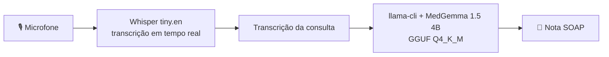

# MedScribeAI

Escriba médico com IA que roda **100% localmente**: ele escuta a consulta entre médico e paciente, transcreve o áudio em tempo real e gera uma **nota clínica no formato SOAP** (Subjetivo, Objetivo, Avaliação, Plano) usando o **MedGemma 1.5 4B**.

Projeto desenvolvido para o [MedGemma Impact Challenge (Kaggle)](https://www.kaggle.com/competitions/med-gemma-impact-challenge/writeups/new-writeup-1771885642738).

O repositório tem duas partes:

- **`app/`**: aplicativo desktop para Windows (Tauri 2), que faz transcrição com Whisper e gera a nota com MedGemma via `llama.cpp`.
- **`notebooks/`**: experimentos de fine-tuning, quantização, avaliação e speech-to-text que deram origem ao modelo e ao pipeline.

> ⚠️ **Aviso:** projeto de pesquisa/educacional. As notas geradas **não substituem o julgamento clínico** e devem sempre ser revisadas por um profissional de saúde. Não use com dados reais de pacientes sem a devida avaliação regulatória e de privacidade (LGPD/HIPAA).

---

## Como funciona



1. O áudio do microfone selecionado é capturado e segmentado com detecção de voz (VAD).
2. Cada trecho é transcrito localmente pelo **Whisper** (`ggml-tiny.en.bin`).
3. Ao final, a transcrição é enviada ao **MedGemma 1.5 4B-it** (quantizado em Q4_K_M), executado pelo `llama-cli` como *sidecar*, que devolve a nota com as seções **Subjective / Objective / Assessment / Plan**.

Nenhum áudio ou texto sai da máquina: os modelos são baixados uma vez e depois tudo roda offline, só na CPU.

---

## Aplicativo desktop (`app/`)

### Estrutura

```
app/
├── medscribeai.exe        # Aplicativo (Tauri 2 + WebView2)
├── uninstall.exe          # Desinstalador
└── binaries/
    └── llama-cli.exe      # Sidecar do llama.cpp usado para inferência do MedGemma
```

### Requisitos

- Windows 10/11 (x64)
- [Microsoft Edge WebView2 Runtime](https://developer.microsoft.com/microsoft-edge/webview2/) (já vem instalado no Windows 11)
- Microfone
- ~4 GB livres em disco para os modelos e 8 GB de RAM ou mais (recomendado)
- Conexão com a internet **apenas** no primeiro uso, para baixar os modelos

### Uso

1. Execute `app/medscribeai.exe`.
2. Na **tela de configuração**, baixe os modelos necessários:
   | Componente | Modelo | Origem |
   |---|---|---|
   | Motor de transcrição | Whisper tiny (inglês) | [`ggerganov/whisper.cpp`](https://huggingface.co/ggerganov/whisper.cpp) → `ggml-tiny.en.bin` |
   | Motor de sumarização | MedGemma 1.5 4B-it Q4_K_M | [`unsloth/medgemma-1.5-4b-it-GGUF`](https://huggingface.co/unsloth/medgemma-1.5-4b-it-GGUF) → `medgemma-1.5-4b-it-Q4_K_M.gguf` |
3. Escolha o microfone (há um teste de nível de áudio) e ajuste, se quiser, a sensibilidade do VAD e a duração máxima de cada trecho.
4. Inicie a transcrição durante a consulta e pare ao terminar.
5. Clique para **gerar a nota SOAP**. O resultado pode ser revisado e salvo, e fica associado ao paciente cadastrado no app.

> O Whisper `tiny.en` é treinado só em inglês, então a transcrição funciona melhor com consultas nesse idioma.

### Solução de problemas

| Mensagem | O que fazer |
|---|---|
| `could not locate llama-cli sidecar binary` | Confirme que `binaries/llama-cli.exe` está ao lado do executável. |
| `could not locate MedGemma GGUF model in app data` | Baixe o MedGemma na tela de configuração. |
| `MedGemma model marker exists but file is missing` | O download foi interrompido ou o arquivo foi apagado. Baixe de novo na tela de configuração. |
| `Whisper tiny model not downloaded` | Baixe o Whisper na tela de configuração. |
| `selected microphone was not found` | O app passou a usar o dispositivo padrão. Selecione outro microfone. |

---

## Notebooks (`notebooks/`)

Os notebooks foram feitos para o **Google Colab** com GPU e leem o token do Hugging Face de `userdata` (`HF_TOKEN` / `HF_TOKEN_WRITE`).

| Notebook | Descrição |
|---|---|
| [`Apply_MedGemma_to_ACI-BENCH`](notebooks/Apply_MedGemma_to_ACI-BENCH) | Primeiro experimento completo: pré-processamento do ACI-Bench, fine-tuning LoRA, avaliação do modelo base vs. ajustado e teste de geração incremental de notas com `llama-cpp-python`. |
| [`Fine-tune_MedGemma_for_SOAP.ipynb`](notebooks/Fine-tune_MedGemma_for_SOAP.ipynb) | Fine-tuning com Unsloth/TRL para gerar notas SOAP a partir de transcrições. |
| [`finetune-medgemma-t4.ipynb`](notebooks/finetune-medgemma-t4.ipynb) | Fine-tuning QLoRA (4-bit NF4) adaptado à GPU **T4** do Colab, com avaliação. |
| [`finetune_medgemma_fixed.ipynb`](notebooks/finetune_medgemma_fixed.ipynb) | Versão revisada do pipeline de fine-tuning. |
| [`finetune_medgemma_H100.ipynb`](notebooks/finetune_medgemma_H100.ipynb) | Fine-tuning otimizado para **H100** (com fallback para outras GPUs) e envio dos adaptadores ao Hub. |
| [`evaluate.ipynb`](notebooks/evaluate.ipynb) | Compara o modelo base com o adaptador LoRA (ROUGE, BLEU, BERTScore, cross-entropy e perplexidade). |
| [`Inference-on-trained-model.ipynb`](notebooks/Inference-on-trained-model.ipynb) | Gera predições no conjunto de teste com o adaptador e salva em JSONL para avaliação offline. |
| [`medgemma_inference.ipynb`](notebooks/medgemma_inference.ipynb) | Carrega os adaptadores do Hub, faz o merge e avalia no ACI-Bench. |
| [`Create-text-only-medgemma.ipynb`](notebooks/Create-text-only-medgemma.ipynb) | Remove o encoder de visão do MedGemma (multimodal) e gera um checkpoint **somente texto** (`Gemma3ForCausalLM`). |
| [`Quantize-MedGemma.ipynb`](notebooks/Quantize-MedGemma.ipynb) | Converte o modelo para **GGUF** e quantiza (ex.: `Q4_K_M`) com `llama.cpp`. |
| [`Test_Speech_to_Text.ipynb`](notebooks/Test_Speech_to_Text.ipynb) | Prova de conceito de transcrição com `faster-whisper` (e diarização opcional com `pyannote`). |
| [`upload_google_medasr_to_hf.ipynb`](notebooks/upload_google_medasr_to_hf.ipynb) | Copia o modelo `google/medasr` para um repositório no Hugging Face. |

### Dados

- **[ACI-Bench](https://huggingface.co/datasets/mkieffer/ACI-Bench)** (`mkieffer/ACI-Bench`, config `aci`): diálogos médico-paciente pareados com notas clínicas de referência. Usamos as divisões `train` / `valid` e `test1`–`test3`.
- Pré-processamento para imitar uma transcrição real: tiramos as marcações `[doctor]` / `[patient]` e as quebras de linha e, opcionalmente, injetamos **ruído de transcrição** (remoção aleatória de ~2% das palavras).

### Configuração de fine-tuning (resumo)

| Parâmetro | Valor |
|---|---|
| Modelo base | `google/medgemma-1.5-4b-it` |
| Método | QLoRA (4-bit NF4, double quant, compute em bf16) |
| LoRA | `r=8`, `alpha=16`, `dropout=0.05–0.1`, `target_modules="all-linear"` |
| Learning rate | `2e-4` |
| Biblioteca | `transformers`, `peft`, `trl` (`SFTTrainer`), `bitsandbytes` |

### Modelos publicados no Hugging Face

- [`gabrielbuzzi/medgemma-aci-lora`](https://huggingface.co/gabrielbuzzi/medgemma-aci-lora): adaptador LoRA treinado no ACI-Bench
- [`gabrielbuzzi/medgemma-1.5-4b-it-text-only`](https://huggingface.co/gabrielbuzzi/medgemma-1.5-4b-it-text-only): MedGemma somente texto
- [`luislvieira/medgemma-4b-it-medical-summarization-lora`](https://huggingface.co/luislvieira/medgemma-4b-it-medical-summarization-lora): adaptador LoRA do primeiro experimento

### Resultados preliminares

Métricas do adaptador LoRA no conjunto de teste do ACI-Bench, registradas nas saídas de [`finetune-medgemma-t4.ipynb`](notebooks/finetune-medgemma-t4.ipynb) em duas execuções:

| Métrica | Execução 1 | Execução 2 |
|---|---|---|
| ROUGE-1 | 0.371 | 0.420 |
| ROUGE-2 | 0.124 | 0.133 |
| ROUGE-L | 0.185 | 0.184 |
| BLEU | 0.049 | 0.055 |
| BERTScore F1 | 0.839 | 0.800 |
| Perplexidade | 11.75 | 10.09 |

Como referência, o modelo base avaliado em [`Apply_MedGemma_to_ACI-BENCH`](notebooks/Apply_MedGemma_to_ACI-BENCH) teve ROUGE-1 de 0.060 e BERTScore F1 de 0.791. Essa avaliação, porém, limitou a geração a 40 tokens, então **não é comparável diretamente** com os números acima.

---

## Reproduzindo o pipeline

1. **Fine-tuning**: rode `finetune-medgemma-t4.ipynb` (T4) ou `finetune_medgemma_H100.ipynb` (H100) e publique o adaptador no Hub.
2. **Avaliação**: rode `evaluate.ipynb` para comparar com o modelo base.
3. **Somente texto**: rode `Create-text-only-medgemma.ipynb` para tirar a torre de visão e reduzir o tamanho do modelo.
4. **Quantização**: rode `Quantize-MedGemma.ipynb` para gerar o `.gguf` (ex.: `Q4_K_M`).
5. **Uso local**: carregue o `.gguf` com `llama.cpp` / `llama-cli`, como faz o app desktop.

---

## Tecnologias

- **Modelos:** [MedGemma 1.5](https://huggingface.co/google/medgemma-1.5-4b-it) (Google), [Whisper](https://github.com/openai/whisper) / [whisper.cpp](https://github.com/ggerganov/whisper.cpp)
- **Inferência:** [llama.cpp](https://github.com/ggerganov/llama.cpp) (GGUF)
- **Treino:** Hugging Face `transformers`, `peft`, `trl`, `bitsandbytes`, Unsloth
- **Avaliação:** `evaluate` (ROUGE, BLEU), `bert-score`
- **Desktop:** [Tauri 2](https://tauri.app/) (Rust + WebView2)

## Autores

- Eduardo Carvalheira Teixeira de Aguiar
- Gabriel Buzzi Sanches
- Luis Antonio Vieira

## Submissão

Projeto submetido ao **MedGemma Impact Challenge** no Kaggle: [ver writeup](https://www.kaggle.com/competitions/med-gemma-impact-challenge/writeups/new-writeup-1771885642738).

## Licenças e uso dos modelos

O MedGemma está sujeito aos [Health AI Developer Foundations Terms of Use](https://developers.google.com/health-ai-developer-foundations/terms) do Google. O dataset ACI-Bench e o Whisper têm licenças próprias. Confira os termos de cada componente antes de redistribuir.
